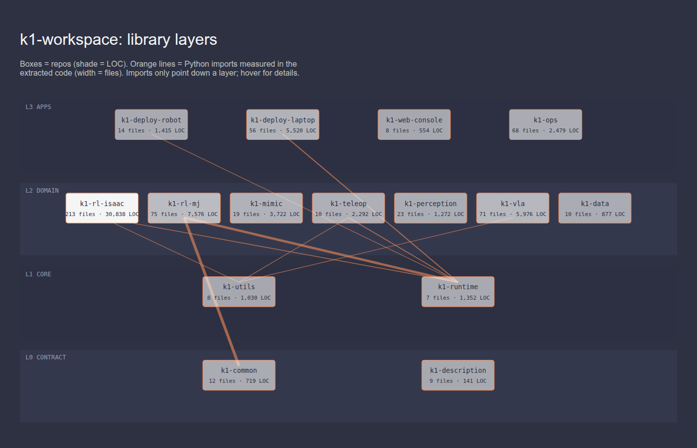
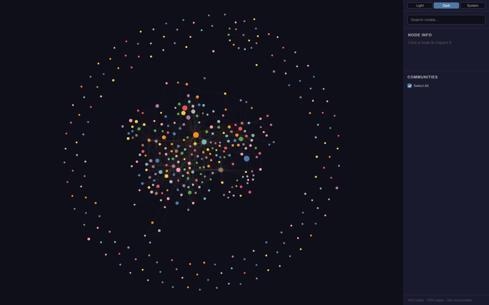

# k1-workspace

Umbrella for the Booster K1 code base, split from the monolithic `booster_ws` into 15 layered libraries (git submodules under `libs/`).

| Repo | Layer | Purpose | Files | LOC |
|---|---|---|---|---|
| [k1-common](https://github.com/thdhyan/k1-common) | L0 | Robot contract: joints, gains, obs/action layout, wiring, motion-clip schema. | 12 | 719 |
| [k1-description](https://github.com/thdhyan/k1-description) | L0 | K1 URDF / MJCF / USD description (ROS 2 package); meshes come from the booster_assets submodule. | 9 | 141 |
| [k1-utils](https://github.com/thdhyan/k1-utils) | L1 | Eval gates, checkpoint inspect/migrate, parity checks, Isaac ROS env helper. | 8 | 1,030 |
| [k1-runtime](https://github.com/thdhyan/k1-runtime) | L1 | Torch/numpy-only policy runtime: WBC, push-IK core, arm IK, DS4 pad, gamepad core. | 7 | 1,352 |
| [k1-rl-isaac](https://github.com/thdhyan/k1-rl-isaac) | L2 | Isaac Lab tasks (velocity, push, kick, COMPASS) and Isaac sim nodes. | 213 | 30,838 |
| [k1-rl-mj](https://github.com/thdhyan/k1-rl-mj) | L2 | mjlab (MuJoCo Warp) tasks, probes and train/play CLI. | 75 | 7,576 |
| [k1-mimic](https://github.com/thdhyan/k1-mimic) | L2 | Video/text to K1 motion retargeting (GVHMR, GMR, SOMA, Kimodo) with a Gradio UI. | 19 | 3,722 |
| [k1-teleop](https://github.com/thdhyan/k1-teleop) | L2 | XR / PhaseSpace teleop nodes, HMD poser, mapping. | 10 | 2,292 |
| [k1-perception](https://github.com/thdhyan/k1-perception) | L2 | SLAM chain: cuVSLAM, TCP relay, nvblox stream, grid map. | 23 | 1,272 |
| [k1-vla](https://github.com/thdhyan/k1-vla) | L2 | k1_chat voice/VLM agent, tools and YOLO node. | 71 | 5,976 |
| [k1-data](https://github.com/thdhyan/k1-data) | L2 | Rosbag, stereo/walk tooling, real-robot converters. | 10 | 877 |
| [k1-deploy-robot](https://github.com/thdhyan/k1-deploy-robot) | L3 | Runs on the K1 CPU: policy runner, TF service, watchdog, recorders. | 14 | 1,415 |
| [k1-deploy-laptop](https://github.com/thdhyan/k1-deploy-laptop) | L3 | ROS 2 jazzy workspace, push-IK web/sim, pad sender, sim-to-sim. | 56 | 5,520 |
| [k1-web-console](https://github.com/thdhyan/k1-web-console) | L3 | Fleet dashboard and camera tools; one web shell, plugin pages over HTTP/WS. | 8 | 554 |
| [k1-ops](https://github.com/thdhyan/k1-ops) | L3 | Host launchers, containers, CI, job chains. | 68 | 2,479 |

## Visualisations

### Layer map (measured imports)

Imports only point down. Line width = number of importing files. Interactive version: [`docs/architecture.html`](docs/architecture.html) (open locally).



### Code knowledge graph (graphify)

6,067 nodes / 13,044 edges from the AST of all 15 repos. The interactive viewer shows the 400 community-level nodes (one per cluster); open `graphify-out/graph.html` locally. Details: [`graphify-out/GRAPH_REPORT.md`](graphify-out/GRAPH_REPORT.md).



## Docs

[Robots, IPs and control](docs/ROBOTS.md) · [Architecture](docs/ARCHITECTURE.md) · [Test report](docs/TEST_REPORT.md) · [Plan](docs/Tasks_and_Plans.md) · [Migration](docs/MIGRATION.md) · [Known issues](docs/KNOWN_ISSUES.md) · [Old docs](docs/legacy/)

## Use

```bash
git clone --recurse-submodules git@github.com:thdhyan/k1-workspace.git
scripts/dev-install.sh   # editable installs in dependency order
```

Each library README has a "Usage" section (source: `tools/usage/<repo>.md`). Regenerate all library READMEs with
`python3 tools/gen_docs.py` (Python >= 3.11; reads `pyproject.toml`, never writes it).

## Run the tests

```bash
source /opt/ros/jazzy/setup.bash          # rclpy for the teleop / ROS tests
source <venv>/bin/activate                # from scripts/dev-install.sh, or any venv with the libs on PYTHONPATH
export PYTHONPATH=$(ls -d $PWD/libs/*/src | tr '\n' ':'):$PYTHONPATH   # append: keep ROS's path
export BOOSTER_SDK_ROOT=$PWD/libs/k1-deploy-laptop/sdk/booster_robotics_sdk
export PYTEST_DISABLE_PLUGIN_AUTOLOAD=1   # ROS launch_testing plugins abort collection after a module-level skip
python -m pytest -q tests/test_refactor_contracts.py   # cross-library contracts
cd libs/<repo> && python -m pytest -q tests
```

Isaac Lab tests in k1-rl-isaac are deselected by default (`-m isaac` on a GPU host). Latest results: [docs/TEST_REPORT.md](docs/TEST_REPORT.md).
