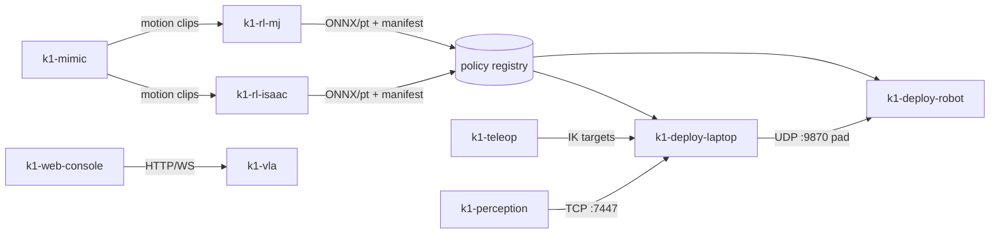

# Architecture

Source of the design: the *booster_ws decoupling map* (Louvain clustering of 495 files / 64k LOC). Measured layering after extraction: see [architecture.html](architecture.html) (generated by `tools/gen_viz.py` from real imports) and the code-level graph in `../graphify-out/graph.html`.

## Layers (imports only point down)

| Layer | Repos | Rule |
|---|---|---|
| L3 Apps | k1-deploy-robot, k1-deploy-laptop, k1-web-console, k1-ops | processes you start |
| L2 Domain | k1-rl-isaac, k1-rl-mj, k1-mimic, k1-teleop, k1-perception, k1-vla, k1-data | no cross-imports; exchange files |
| L1 Core | k1-runtime, k1-utils | torch / numpy only |
| L0 Contract | k1-common, k1-description | no heavy deps |

`pyproject.toml` of each repo lists only the siblings it may import; `tools/gen_docs.py` fails loudly if a measured import is outside that list.

## Data flow between libraries

## Where things run

GPU hosts (dl, zz-bw) train rl-isaac / rl-mj; the DGX Spark runs the mimic service (docker :7861); the laptop runs deploy-laptop + web-console (:8080, :8765) + ops; each K1 runs deploy-robot, the k1-vla agent (:8091) and perception (cuVSLAM :7447). No DDS across Wi-Fi: TCP relay and UDP only.

## Deliberate seam: push-IK runtime

One UDP :9870 protocol and one set of gains are shared by the robot runner, web console, MuJoCo sim and PhaseSpace node. The shared core lives in **k1-runtime** (`wbc`, `push_ik_core`, `ds4`, `k1_arm_ik`, `gamepad_core`); `k1_gamepad_deploy.py` was split into runtime / deploy-robot / deploy-laptop.
